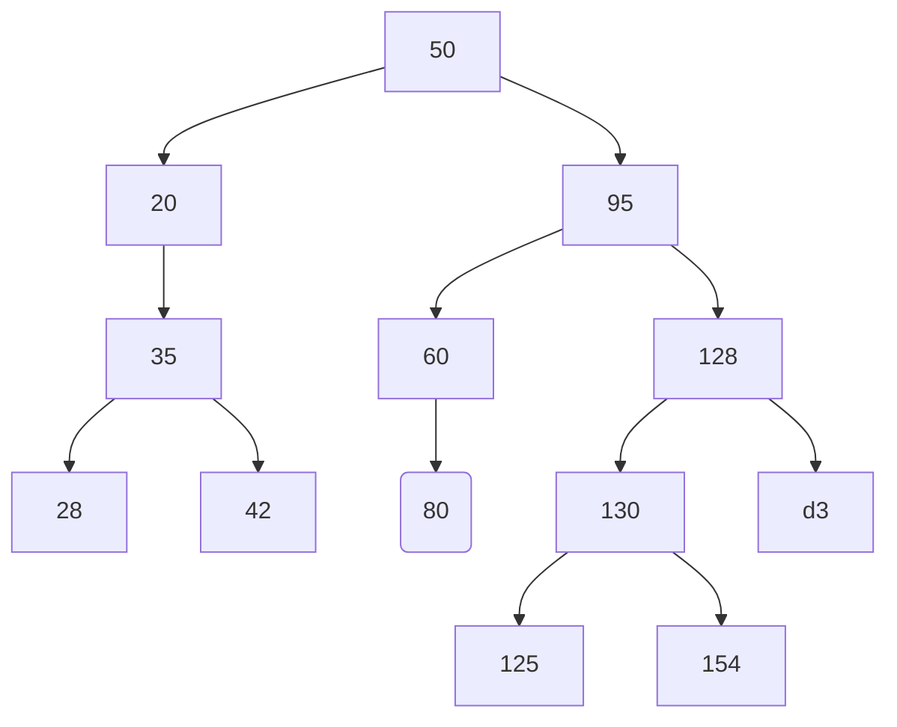

>> 16.10.2026
#### Test:
- posunout prvky v seznamu o +2 (doprava)
aka:
- `arr[i] = arr[i-2]`

## Rekurze

Existuje:
- rekurzivní algoritmy
- rekurzivní (volání) funkce

**Call stack (volací zásobník)**
- pro rekurzivní volání funkce
- není neomezený
- např. limit Pythonu: 1000

**Příklad: factorial**
```python
# Loop
def factorial_loop(n):
    result = 1
    for i in range(1, n + 1):
        result *= i
    return result

# Recursive
def factorial_recursive(n):
    if n == 0 or n == 1:
        return 1
    return n * factorial_recursive(n - 1)

print(factorial_loop(5))       # 120
print(factorial_recursive(5))  # 120
```

**Příklad: palindrom**
```python
# Loop
def palindrome_loop(s):
    for i in range(len(s) // 2):
        if s[i] != s[len(s) - 1 - i]:
            return False
    return True

# Recursive
def palindrome_recursive(s):
    if len(s) <= 1:
        return True
    if s[0] != s[-1]:
        return False
    return palindrome_recursive(s[1:-1])

print(palindrome_loop("racecar"))       # True
print(palindrome_recursive("racecar"))  # True

print(palindrome_loop("hello"))         # False
print(palindrome_recursive("hello"))    # False
```

**Fibonacciho čísla**
```python
# Loop
def fibonacci_loop(n):
	if n <= 2:
		return 1
    a, b = 0, 1
    for i in range(n):
        a, b = b, a + b

    return a

# Recursive
def fibonacci_recursive(n):
    if n == 0 or n == 1:
        return n

    return fibonacci_recursive(n - 1) + fibonacci_recursive(n - 2)

print(fibonacci_loop(6))       # 8
print(fibonacci_recursive(6))  # 8
```
$\uparrow$ Rekurzivní vypočítá stejné hodnoty několikrát

**Potenciální rešení:** 
- cache (aka memoizace)
	- třeba array
	- pak zkontrolovat jestli už existuje
	- $O(2^n) \rightarrow O(n)$
	- potřebuje mnohém více paměti

**Euklidův algoritmus**
```python
# Loop
def gcd_loop(a, b):
    while b != 0:
        (a, b) = (b, a % b)

    return abs(a)

# Recursive
def gcd_recursive(a, b):
    if b == 0:
        return abs(a)

    return gcd_recursive(b, a % b)

print(gcd_loop(48, 18))       # 6
print(gcd_recursive(48, 18))  # 6
```
> $\uparrow$ standardní verze Euklidova algoritmu
> Profesor napsal subtraktivní Euklidův algoritmus

[Classroom >> 16.10.2026](https://classroom.google.com/c/NTQ0Nzg4MTAzMjk2/m/ODkyNjEzOTM1NTk4/details)

---
>> 06.11.2026
## Binární stromy


```python
def vyska1(k):
    h = 0
    def pruchod(uzel, hloubka):
        nonlocal h

        if hloubka > h:
            h = hloubka
        if uzel.levy:
            pruchod(uzel.levy, hloubka + 1)
        if uzel.pravy:
            pruchod(uzel.pravy, hloubka + 1)

    pruchod(k, 1)
    return h
```

```python
def vyska2(k):
    if k == None:
        return 0
    return max(vyska2(k.levy), vyska2(k.pravy)) + 1
```

```python
def vyska3(k):
    h = 0
    z = [(k, 1)]
    while z:
        vrchol, hloubka = z.pop()
        if hloubka > h:
            h = hloubka
        if vrchol.levy:
            z.append((vrchol.levy, hloubka + 1))
        if vrchol.pravy:
            z.append((vrchol.pravy, hloubka + 1))
    return h
```

```python
def vyska4(k):
    f = [(k, 1)]
    while f:
        vrchol, hloubka = f.pop(0)
        if vrchol.levy:
            f.append((vrchol.levy, hloubka + 1))
        if vrchol.pravy:
            f.append((vrchol.pravy, hloubka + 1))
            
    return hloubka
```

```python
def vyska5(k):
    h = 0
    vrstva = [k]
    while vrstva:
        h++ # h += 1
        nova = []
        for x in vrstva:
	        if x.levy:
	            nova.append(x.levy)
	        if x.pravy:
	            nova.append(x.pravy)
            
    return h
```

**Rozdíly**
 - `vyska1`: Rekurzivní DFS s vnořenou funkcí a modifikací proměnné h přes nonlocal.
 - `vyska2`: Čistá rekurze bez pomocných proměnných využívající funkci max a kontrolu na None.
 - `vyska3`: Iterativní DFS využívající explicitní zásobník (z.pop()) a průběžné sledování maxima h.
 - `vyska4`: Iterativní BFS (fronta pomocí pop(0)), která spoléhá na to, že poslední vybraný prvek má maximální hloubku.
 - `vyska5`: Iterativní BFS po vrstvách, která obsahuje syntaktické chyby (h++) a vrací nedefinovanou proměnnou (hloubka).

**BS**
- různé info
	- max hodnota
	- číslo hladiny

**Binární vyhledávací strom**


